# Music Atlas · 摆件收藏

共 34 件透明底 PNG。01–26 与 31–34 在展示页，27–30 单独归档。点图可打开原图。下载仓库并解压，打开 [index.html](index.html) 即可离线试摆。

## 古董设计参考

- 维也纳格栅墨水座 · [大都会艺术博物馆 · Josef Hoffmann 墨水座](https://www.metmuseum.org/art/collection/search/481693)

## 01–26 · 展示中

<table>
<tr>
<td align="center"><a href="assets/clusterlamp.png">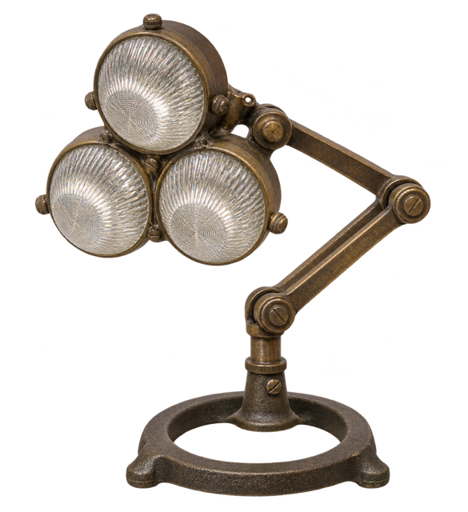 01 · 棱镜集群灯</a></td>
<td align="center"><a href="assets/bugattimirror.png"> 02 · 嵌饰立镜</a></td>
<td align="center"><a href="assets/leafbronzelamp.png"> 03 · 三足叶形灯</a></td>
<td align="center"><a href="assets/scarpa.png">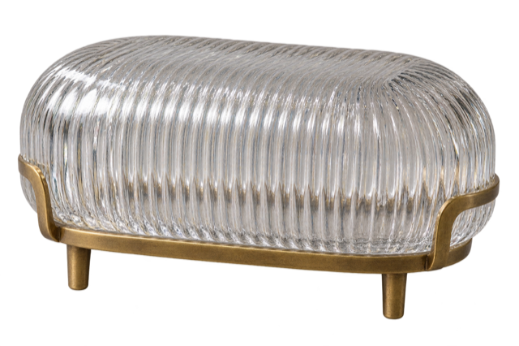 04 · 威尼斯玻璃灯</a></td>
</tr>
</table>

<table>
<tr>
<td align="center"><a href="assets/bugattibase.png"> 05 · 嵌饰唱片托</a></td>
<td align="center"><a href="assets/musebronze.png"> 06 · 铸铜日环</a></td>
<td align="center"><a href="assets/hoffmannink.png"> 07 · 维也纳格栅墨水座</a></td>
<td align="center"><a href="assets/stone.png"> 08 · 太湖石</a></td>
</tr>
</table>

<table>
<tr>
<td align="center"><a href="assets/lamp.png"> 09 · 玻璃灯</a></td>
<td align="center"><a href="assets/turntable.png"> 10 · 黑胶唱机</a></td>
<td align="center"><a href="assets/chrome.png"> 11 · 镀铬台灯</a></td>
<td align="center"><a href="assets/bronze.png"> 12 · 铜雕</a></td>
</tr>
</table>

<table>
<tr>
<td align="center"><a href="assets/speaker.png"> 13 · 书架音箱</a></td>
<td align="center"><a href="assets/censer.png">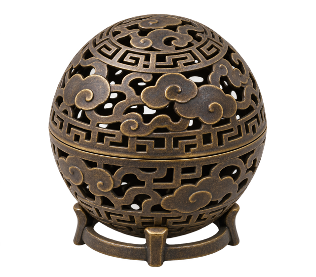 14 · 镂空香炉</a></td>
<td align="center"><a href="assets/wavebox.png">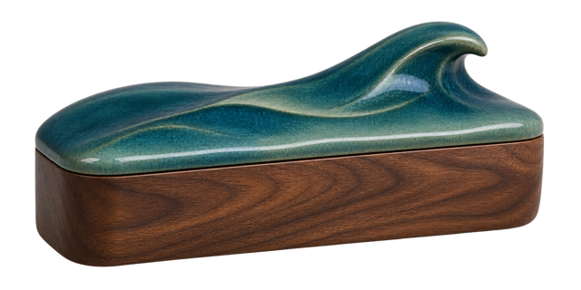 15 · 海浪匣</a></td>
<td align="center"><a href="assets/pleat.png"> 16 · 褶瓷立件</a></td>
</tr>
</table>

<table>
<tr>
<td align="center"><a href="assets/flask.png"> 17 · 银化玻璃瓶</a></td>
<td align="center"><a href="assets/recordbin.png"> 18 · 翻片箱</a></td>
<td align="center"><a href="assets/lava.png"> 19 · 火山釉陶瓶</a></td>
<td align="center"><a href="assets/medal.png"> 20 · 声纹铜章</a></td>
</tr>
</table>

<table>
<tr>
<td align="center"><a href="assets/linenlamp.png">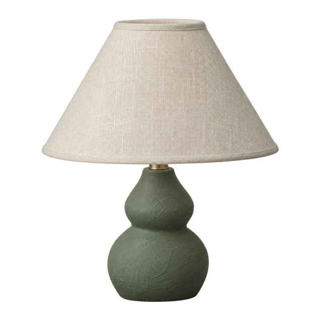 21 · 布罩台灯</a></td>
<td align="center"><a href="assets/drapery.png">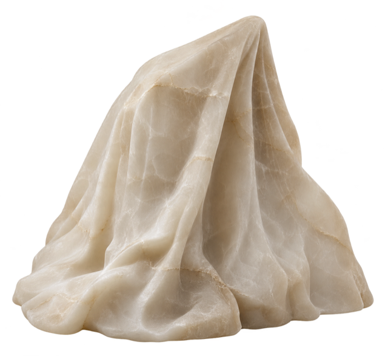 22 · 覆布石雕</a></td>
<td align="center"><a href="assets/eggshell.png"> 23 · 蛋壳漆屏</a></td>
<td align="center"><a href="assets/puck.png"> 24 · 黄铜唱片镇</a></td>
</tr>
</table>

<table>
<tr>
<td align="center"><a href="assets/ewer.png"> 25 · 水晶执壶</a></td>
<td align="center"><a href="assets/opaline.png">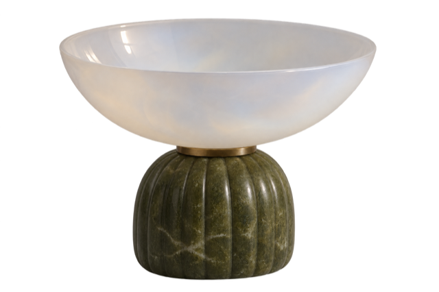 26 · 乳白玻璃灯</a></td>
</tr>
</table>

## 31–34 · 新增展示

<table>
<tr>
<td align="center"><a href="assets/ghosthorse.png">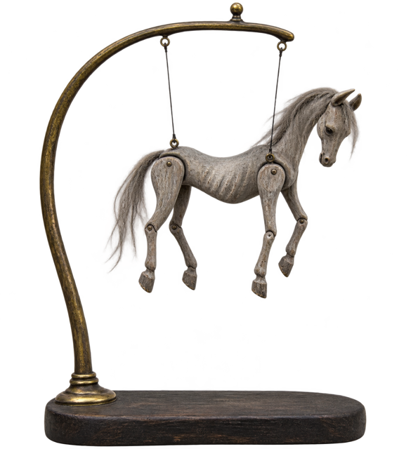 31 · 悬吊幽灵马</a></td>
<td align="center"><a href="assets/silverarc.png">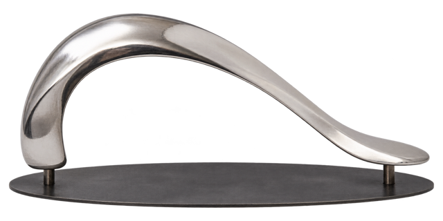 32 · 银弧立件</a></td>
<td align="center"><a href="assets/gardenframe.png">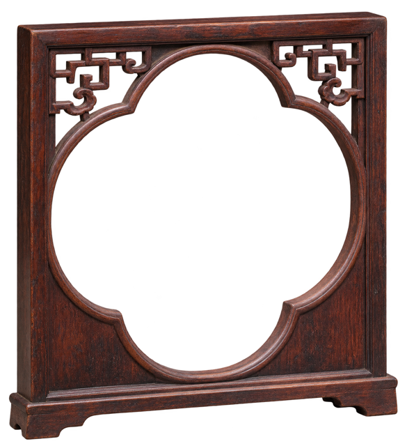 33 · 园林透景框</a></td>
<td align="center"><a href="assets/maskstand.png">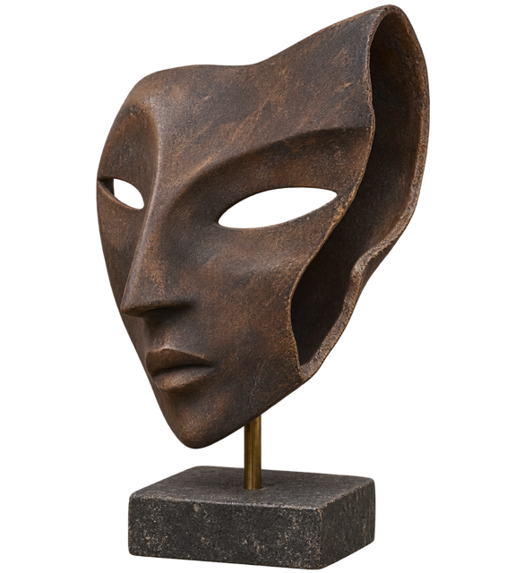 34 · 斜置剧场面具</a></td>
</tr>
</table>

## 27–30 · 已归档

<table>
<tr>
<td align="center"><a href="archive/lacquer.png"> 27 · 漆作托</a></td>
<td align="center"><a href="archive/mirrorweight.png">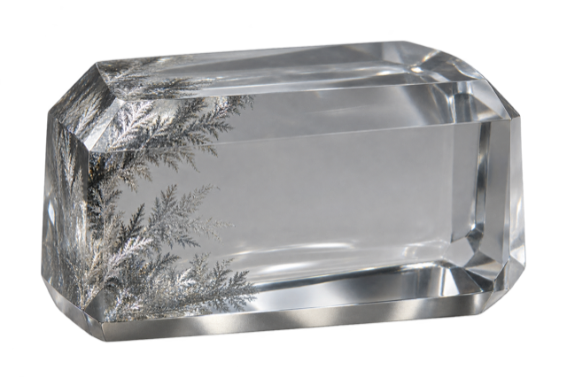 28 · 银镜镇纸</a></td>
<td align="center"><a href="archive/mukozuke.png"> 29 · 陶瓷向付</a></td>
<td align="center"><a href="archive/phonostage.png">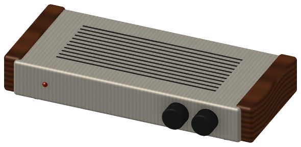 30 · 铝面唱放</a></td>
</tr>
</table>
