# Music Atlas · 摆件收藏

共 36 件透明底 PNG。点图可打开原图。下载仓库并解压，打开 [index.html](index.html) 即可离线试摆。

<table>
<tr>
<td align="center"><a href="assets/phonostage.png"> 铝面唱放</a></td>
<td align="center"><a href="assets/plumtray.png">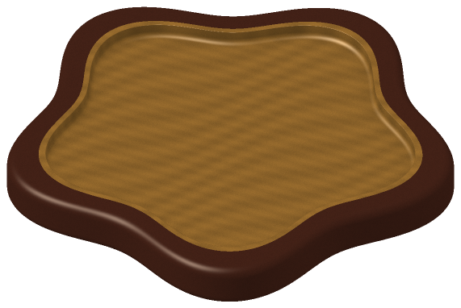 梅形金箔托</a></td>
<td align="center"><a href="assets/porcelainloop.png"> 交环瓷雕</a></td>
<td align="center"><a href="assets/facetpitcher.png">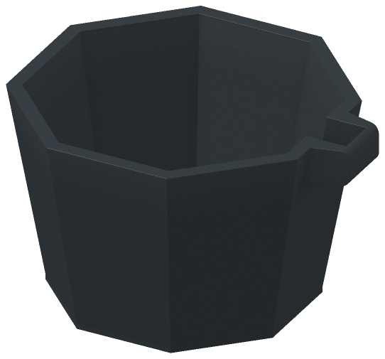 切面公道杯</a></td>
</tr>
</table>

<table>
<tr>
<td align="center"><a href="assets/stone.png">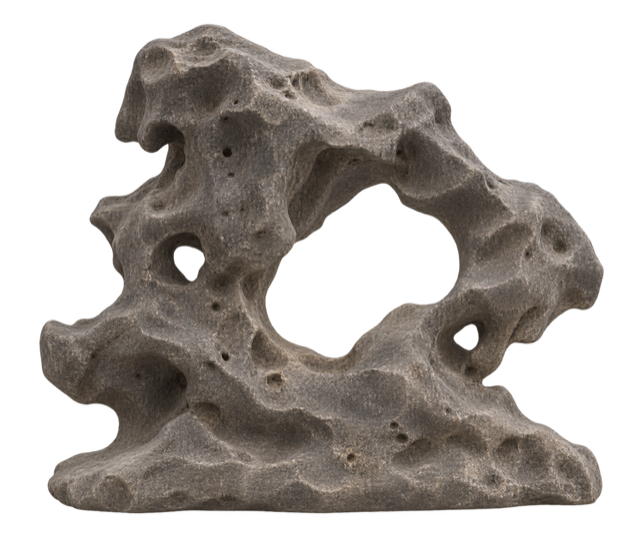 太湖石</a></td>
<td align="center"><a href="assets/lamp.png"> 玻璃灯</a></td>
<td align="center"><a href="assets/lacquer.png">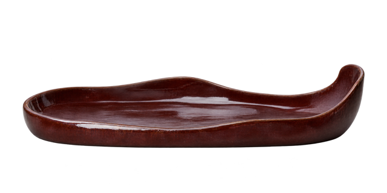 漆作托</a></td>
<td align="center"><a href="assets/celadon.png">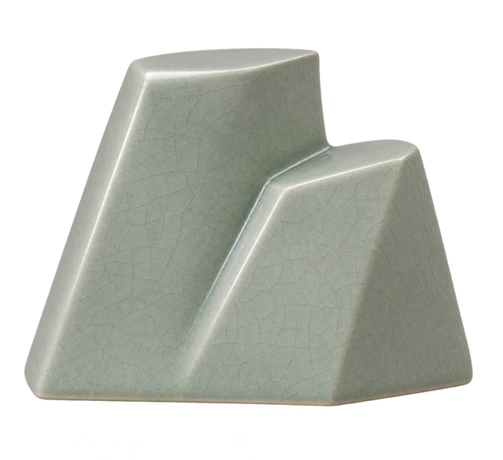 青绿几何</a></td>
</tr>
</table>

<table>
<tr>
<td align="center"><a href="assets/turntable.png">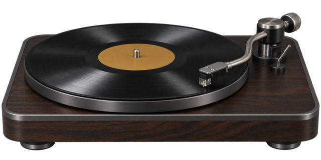 黑胶唱机</a></td>
<td align="center"><a href="assets/inlay.png">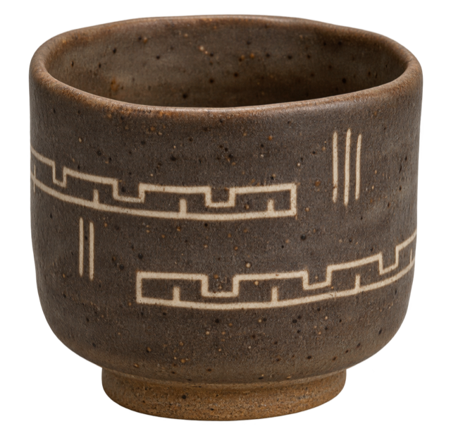 象嵌杯</a></td>
<td align="center"><a href="assets/marbled.png">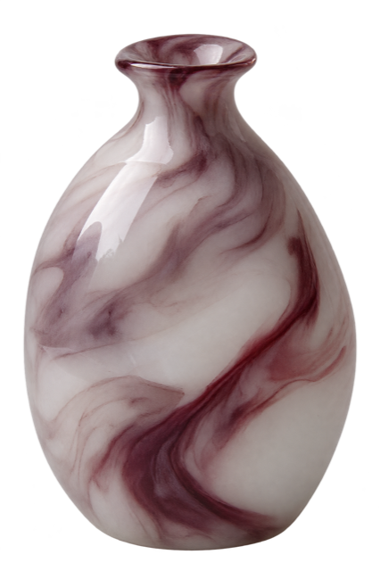 玻璃花器</a></td>
<td align="center"><a href="assets/chrome.png"> 镀铬台灯</a></td>
</tr>
</table>

<table>
<tr>
<td align="center"><a href="assets/lotus.png">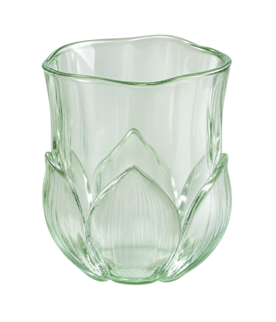 莲苞杯</a></td>
<td align="center"><a href="assets/mukozuke.png">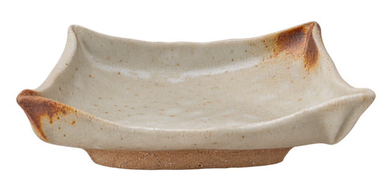 陶瓷向付</a></td>
<td align="center"><a href="assets/crab.png"> 银蟹盒</a></td>
<td align="center"><a href="assets/bronze.png"> 铜雕</a></td>
</tr>
</table>

<table>
<tr>
<td align="center"><a href="assets/speaker.png"> 书架音箱</a></td>
<td align="center"><a href="assets/caddy.png">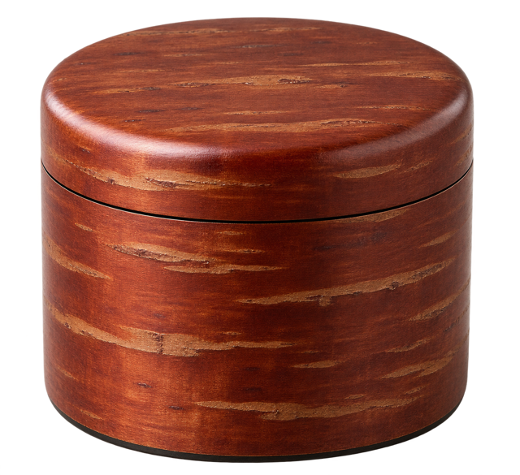 茶叶罐</a></td>
<td align="center"><a href="assets/censer.png"> 镂空香炉</a></td>
<td align="center"><a href="assets/bookend.png">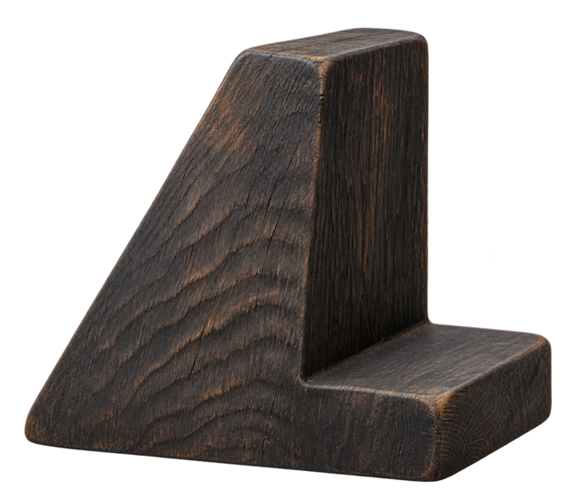 炭木唱片挡</a></td>
</tr>
</table>

<table>
<tr>
<td align="center"><a href="assets/wavebox.png"> 海浪匣</a></td>
<td align="center"><a href="assets/pleat.png"> 褶瓷立件</a></td>
<td align="center"><a href="assets/flask.png">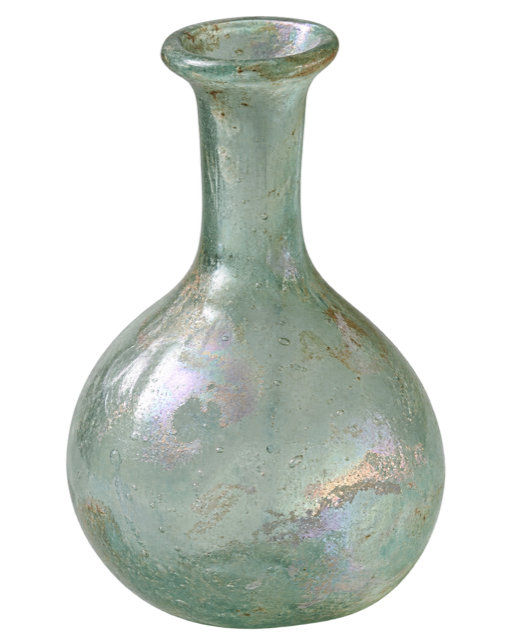 银化玻璃瓶</a></td>
<td align="center"><a href="assets/cane.png">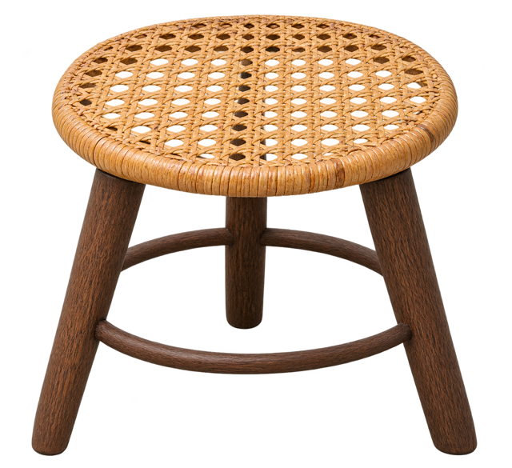 藤编矮凳</a></td>
</tr>
</table>

<table>
<tr>
<td align="center"><a href="assets/recordbin.png"> 翻片箱</a></td>
<td align="center"><a href="assets/facetbowl.png">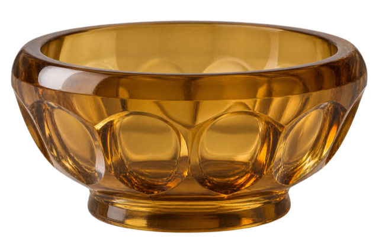 切面玻璃碗</a></td>
<td align="center"><a href="assets/lava.png"> 火山釉陶瓶</a></td>
<td align="center"><a href="assets/medal.png"> 声纹铜章</a></td>
</tr>
</table>

<table>
<tr>
<td align="center"><a href="assets/linenlamp.png"> 布罩台灯</a></td>
<td align="center"><a href="assets/cassettes.png"> 磁带架</a></td>
<td align="center"><a href="assets/mirrorweight.png"> 银镜镇纸</a></td>
<td align="center"><a href="assets/drapery.png"> 覆布石雕</a></td>
</tr>
</table>

<table>
<tr>
<td align="center"><a href="assets/eggshell.png"> 蛋壳漆屏</a></td>
<td align="center"><a href="assets/puck.png">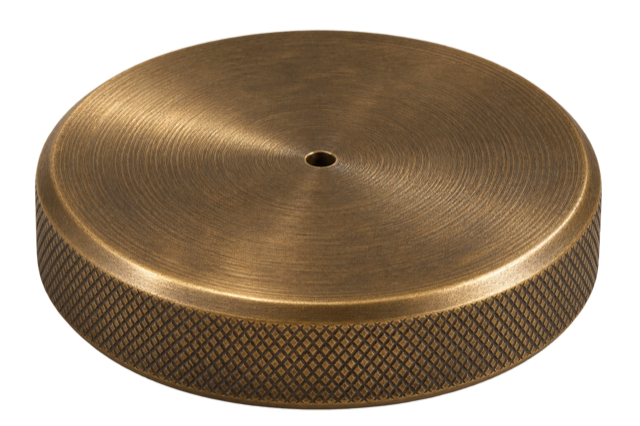 黄铜唱片镇</a></td>
<td align="center"><a href="assets/ewer.png">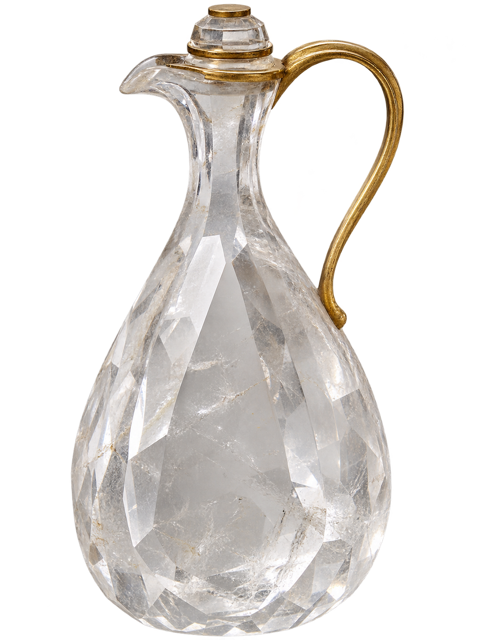 水晶执壶</a></td>
<td align="center"><a href="assets/cubby.png">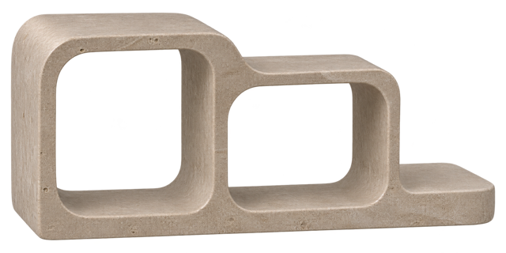 双孔石格</a></td>
</tr>
</table>
