# Music Atlas · 摆件收藏

共 36 件透明底 PNG。点图可打开原图。下载仓库并解压，打开 [index.html](index.html) 即可离线试摆。

## 古董设计参考

- 琥珀树脂收音机 · [SFO Museum · On the Radio](https://www.sfomuseum.org/exhibitions/radio/gallery)
- 装饰艺术座钟 · [大都会艺术博物馆 · Gilbert Rohde 座钟](https://www.metmuseum.org/art/collection/search/490893)
- 维也纳格栅墨水座 · [大都会艺术博物馆 · Josef Hoffmann 墨水座](https://www.metmuseum.org/art/collection/search/481693)
- 流线珐琅台扇 · [蒙特利尔美术馆藏 · Airflow 台扇](https://partnersindesign.org/object/table-fan-airflow/)

## 摆件图集

<table>
<tr>
<td align="center"><a href="assets/bugattimirror.png">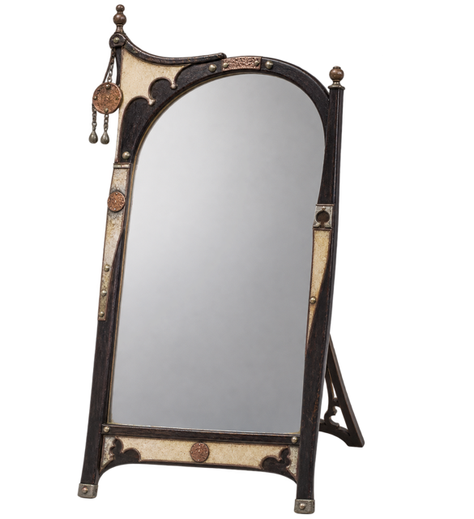 嵌饰立镜</a></td>
<td align="center"><a href="assets/leafbronzelamp.png">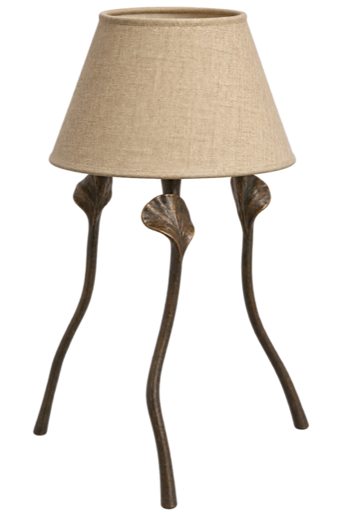 三足叶形灯</a></td>
<td align="center"><a href="assets/whitehandwheel.png">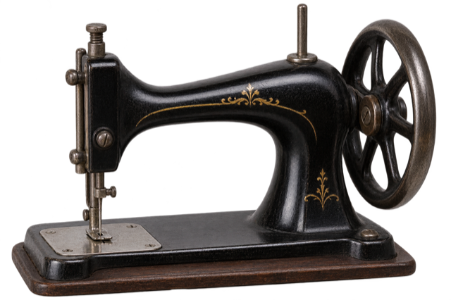 手轮缝纫机</a></td>
<td align="center"><a href="assets/buffachair.png">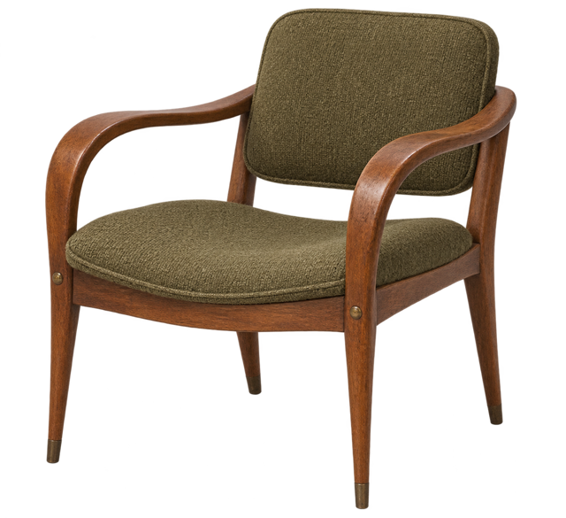 胡桃木扶手椅</a></td>
</tr>
</table>

<table>
<tr>
<td align="center"><a href="assets/scarpa.png"> 威尼斯玻璃灯</a></td>
<td align="center"><a href="assets/bugattibase.png">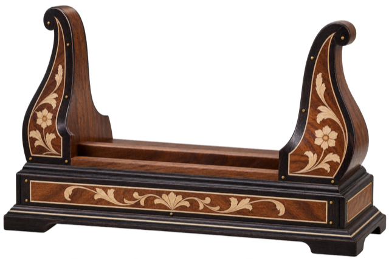 嵌饰唱片托</a></td>
<td align="center"><a href="assets/cantu.png">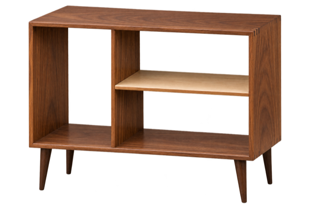 意式矮展柜</a></td>
<td align="center"><a href="assets/musebronze.png">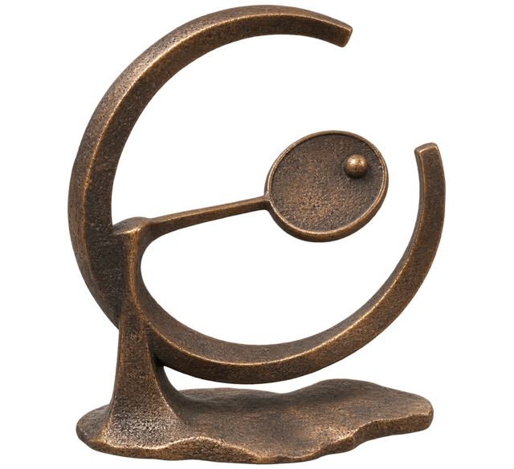 铸铜日环</a></td>
</tr>
</table>

<table>
<tr>
<td align="center"><a href="assets/catalin.png">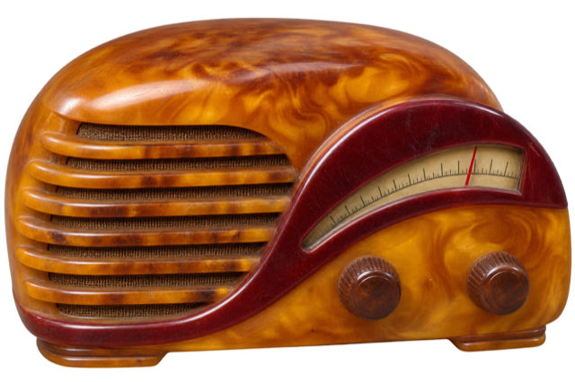 琥珀树脂收音机</a></td>
<td align="center"><a href="assets/rohdeclock.png">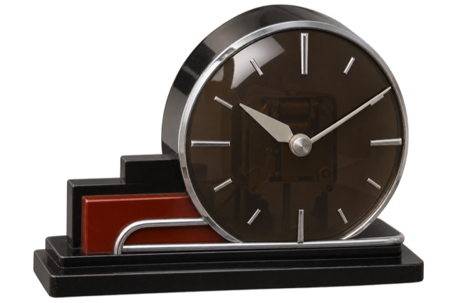 装饰艺术座钟</a></td>
<td align="center"><a href="assets/hoffmannink.png">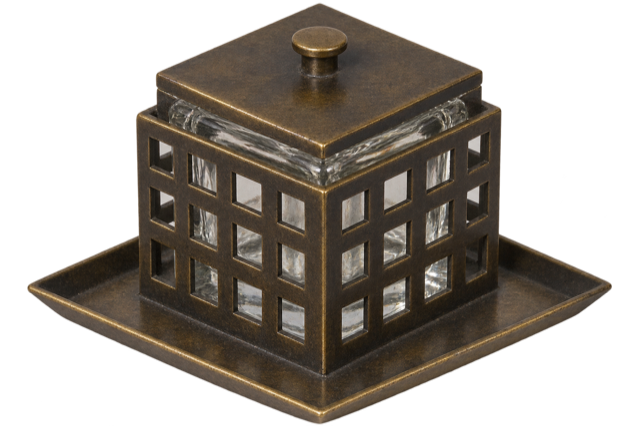 维也纳格栅墨水座</a></td>
<td align="center"><a href="assets/airflow.png">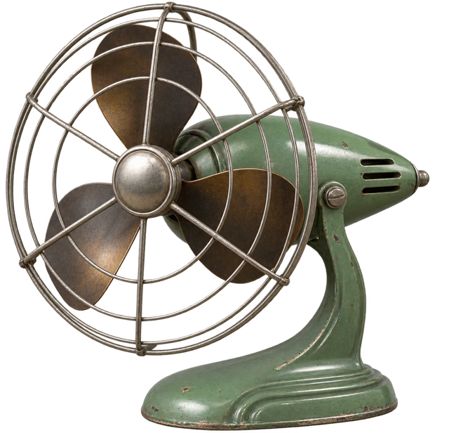 流线珐琅台扇</a></td>
</tr>
</table>

<table>
<tr>
<td align="center"><a href="assets/stone.png"> 太湖石</a></td>
<td align="center"><a href="assets/lamp.png">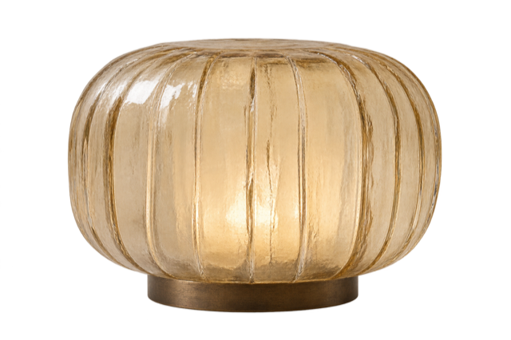 玻璃灯</a></td>
<td align="center"><a href="assets/turntable.png"> 黑胶唱机</a></td>
<td align="center"><a href="assets/chrome.png">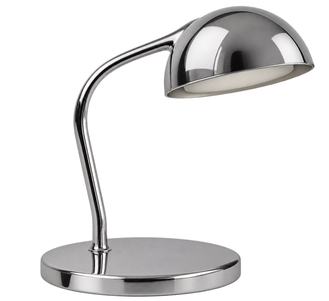 镀铬台灯</a></td>
</tr>
</table>

<table>
<tr>
<td align="center"><a href="assets/crab.png">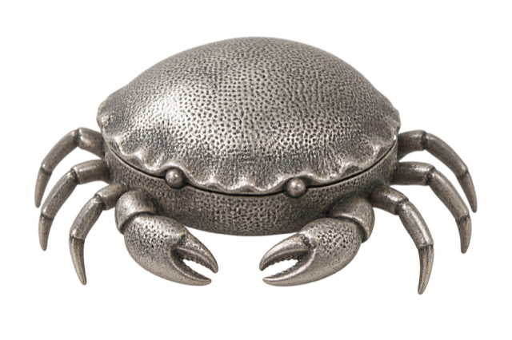 银蟹盒</a></td>
<td align="center"><a href="assets/bronze.png">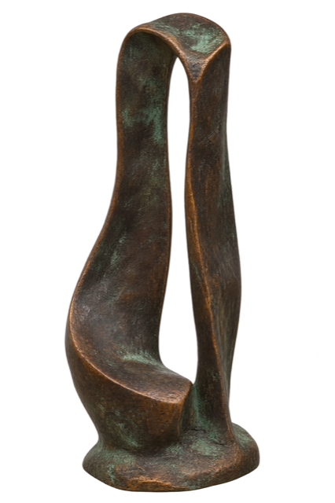 铜雕</a></td>
<td align="center"><a href="assets/speaker.png">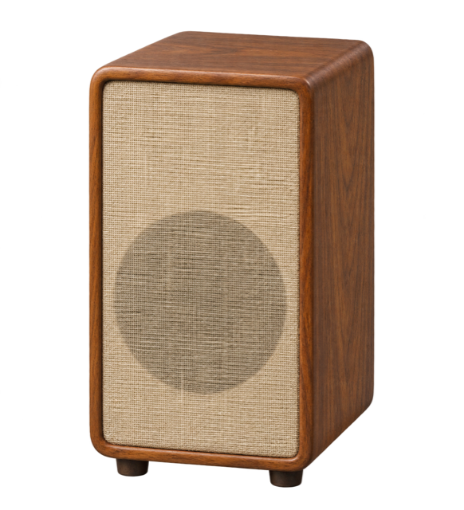 书架音箱</a></td>
<td align="center"><a href="assets/censer.png"> 镂空香炉</a></td>
</tr>
</table>

<table>
<tr>
<td align="center"><a href="assets/bookend.png"> 炭木唱片挡</a></td>
<td align="center"><a href="assets/wavebox.png"> 海浪匣</a></td>
<td align="center"><a href="assets/pleat.png">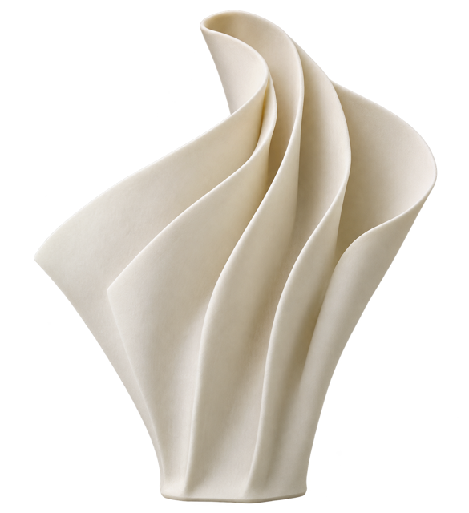 褶瓷立件</a></td>
<td align="center"><a href="assets/flask.png"> 银化玻璃瓶</a></td>
</tr>
</table>

<table>
<tr>
<td align="center"><a href="assets/recordbin.png">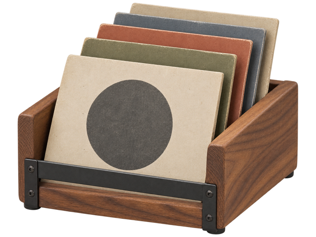 翻片箱</a></td>
<td align="center"><a href="assets/lava.png">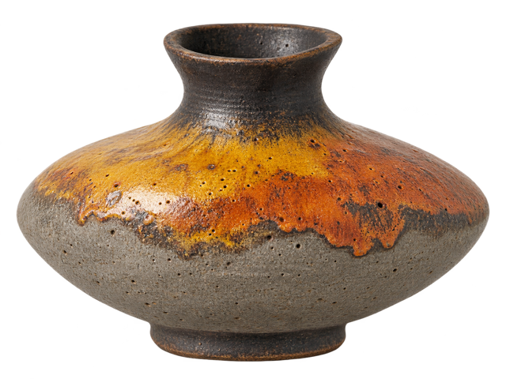 火山釉陶瓶</a></td>
<td align="center"><a href="assets/medal.png">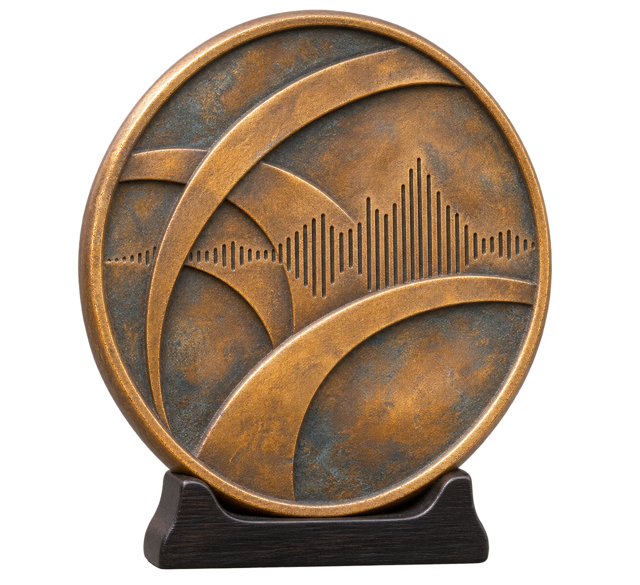 声纹铜章</a></td>
<td align="center"><a href="assets/linenlamp.png"> 布罩台灯</a></td>
</tr>
</table>

<table>
<tr>
<td align="center"><a href="assets/cassettes.png">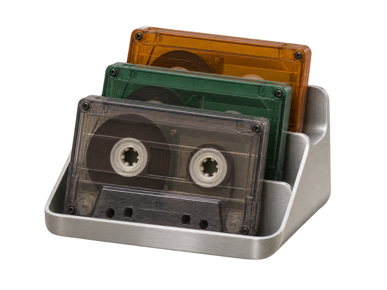 磁带架</a></td>
<td align="center"><a href="assets/drapery.png"> 覆布石雕</a></td>
<td align="center"><a href="assets/eggshell.png">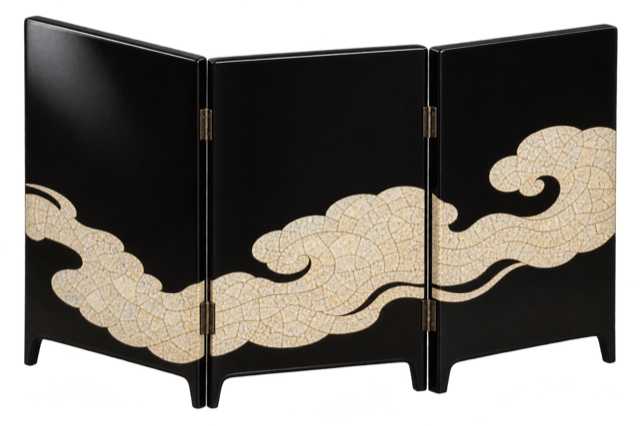 蛋壳漆屏</a></td>
<td align="center"><a href="assets/puck.png"> 黄铜唱片镇</a></td>
</tr>
</table>

<table>
<tr>
<td align="center"><a href="assets/ewer.png"> 水晶执壶</a></td>
<td align="center"><a href="assets/porcelainloop.png">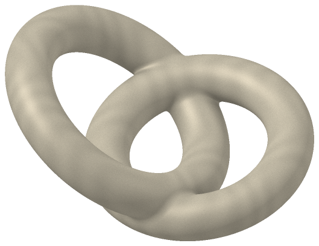 交环瓷雕</a></td>
<td align="center"><a href="assets/opaline.png"> 乳白玻璃灯</a></td>
<td align="center"><a href="assets/murano.png">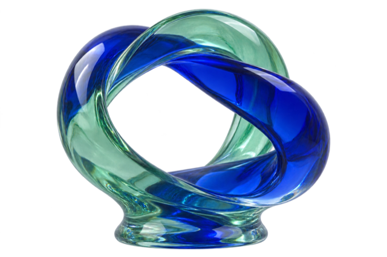 蓝绿玻璃结</a></td>
</tr>
</table>
